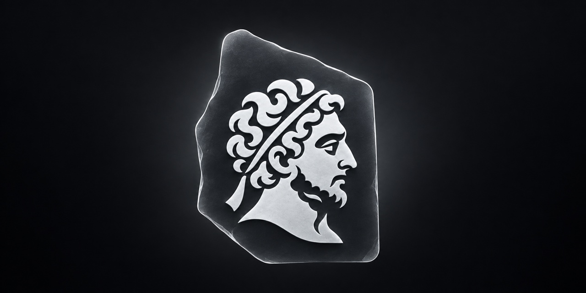

<p align="center"></p>

# Ptolemy

Ptolemy is a PowerPC Mac emulator for Apple silicon. It runs Mac OS X Tiger 10.4.11 for PowerPC, unmodified (its own
kernel, drivers, Finder and applications), in a window or full screen on a current Mac. Tiger's PowerPC code is
translated to ARM64 and runs on the Mac's CPU cores under Hypervisor.framework; Tiger's own ATI driver drives an
emulated Radeon 9700 whose 2D and 3D work runs on the Mac's GPU through Metal.

**1.0 beta 1.** A hobby project, made for fun. Expect rough edges: most applications and games have never been tried.
[Download it](#download) or [build it](#building).

## Emulated, translated, native

Ptolemy is an emulator: Apple silicon cannot run PowerPC code, and every part of the PowerBook G4 that Tiger sees is
modelled in software. What makes it fast is where that work runs.

- **Emulated: the machine.** The board, disk, CD/DVD, USB, network, sound and the Radeon 9700 are models written for
  Ptolemy, close enough to the real hardware for Tiger's own drivers.
- **Translated: the processor.** Epicycle compiles Tiger's PowerPC code, the kernel included, to ARM64 one block at a
  time and keeps the translations; an interpreter handles rare instructions and corner cases.
- **On the Mac's hardware.** The translated code runs on the Mac's CPU cores inside a Hypervisor.framework vCPU. The
  Mac's MMU does the PowerPC's address translation through page tables that mirror Tiger's, so a guest load or store
  is an ARM64 load or store and a byte swap. The Radeon's drawing runs on the Mac's GPU: its vertex and fragment
  programs become Metal shaders.
- **Added to Tiger.** Ptolemy's display driver (modes up to the window's size, cursor, gamma), which the firmware hands
  to Tiger, and Ptolemy Agent (clipboard, file transfer, shut down), which Ptolemy.app installs with each machine.
  Both talk to Ptolemy through private calls instead of emulated hardware. Tiger's own files are not changed.

Hypervisor.framework gives the translated code a memory management unit and isolation; it does not run Tiger's code
as it is, the way a virtual machine runs a guest made for the same processor. Rosetta 2 is the nearer comparison: it
translates an Intel app's code for macOS, while Epicycle translates a whole PowerPC system, kernel and drivers
included, on emulated hardware.

## How it differs from other emulators

The usual way to run PowerPC Mac OS X on a Mac today is QEMU, directly or through UTM. SheepShaver, the other
well-known one, runs Mac OS 9.0.4 and earlier, not Mac OS X. Ptolemy differs from QEMU in how it runs the processor
and the graphics card:

- **Processor.** QEMU translates PowerPC code with its portable code generator (TCG) in an ordinary process, and every
  guest memory access looks its address up in a software TLB. Epicycle generates ARM64 code directly and leaves
  address translation to the Mac's MMU.
- **Graphics.** QEMU's Mac board has a plain framebuffer, so Tiger runs without Quartz Extreme and OpenGL falls back to
  Apple's software renderer on the emulated processor. In Ptolemy, Tiger's ATI driver accelerates Quartz Extreme,
  Core Image and OpenGL on the Mac's GPU.

On a MacBook Air with the M4, Tiger in Ptolemy scores about 4400 in Geekbench 2.2 (a Power Mac G5 at 1.6 GHz scores
1000), runs Halo's built-in time demo at 82.5 fps and reaches its desktop about 10 seconds after the machine starts.
Published Geekbench 2.2 results for Tiger in [QEMU 7.0 on an M1 Mac mini](https://browser.geekbench.com/geekbench2/2730728)
and [UTM 3.2.4 on an M1 Pro MacBook Pro](https://browser.geekbench.com/geekbench2/2730718) are 731 and 774. Those Macs
are older, so the comparison is approximate.

QEMU runs on almost any computer and starts many more systems: Mac OS 9, other versions of Mac OS X, Linux. Ptolemy
needs a Mac with Apple silicon and so far runs Tiger only.

## Graphics on Metal

Optics, the Radeon 9700 model, works at the level of the card's registers and command ring, so Tiger's ATI driver,
OpenGL and Quartz Extreme run as they would on the real card. Each draw the driver sends becomes one Metal draw: the
card's vertex and fragment programs are translated to Metal shaders, textures are decoded on the GPU, render targets
live in Metal textures that own the guest's video memory, and the driver's fences complete from Metal's completion
handlers. [docs/graphics.md](docs/graphics.md) describes it in detail and lists what is not covered yet.

## Components

| Name | What it is | Where |
|---|---|---|
| **Epicycle** | PowerPC G3/G4 to ARM64 JIT that runs inside Hypervisor.framework; AltiVec on NEON | `epicycle/` |
| **Optics** | ATI Radeon 9700 (R300) model: command processor, 2D engine, vertex and fragment programs translated to Metal. Tiger's own ATI driver drives it, so Quartz Extreme, Core Image and OpenGL games run on the Mac's GPU | `src/optics/` |
| **Harmonics** | Screamer sound and its DBDMA channels, played through Core Audio | `src/audio.c`, `src/audio_macos.c` |
| Machine | PowerBook5,8: G4 7447A 1.67 GHz, 2 GB, MacIO, PMU, ATA disk, ATAPI CD/DVD, USB keyboard, tablet, mouse and storage, RTL8139 Ethernet with user-mode networking, NVRAM | `src/`, `include/` |
| Firmware | A fork of [OpenBIOS](https://github.com/openbios/openbios) (Open Firmware), built reproducibly | `firmware/openbios/` |
| Ptolemy Tools | Runs inside Tiger: display driver (modes, hardware cursor, gamma), clipboard, file transfer, orderly restart and shut down | `guest/` |
| Ptolemy.app | Launcher: installs Tiger from your own DVD image, keeps several machines, sets disk size, processor and memory | `product/` |

The firmware is the only third-party code in the machine; everything else was written for Ptolemy.
[THIRD-PARTY.md](THIRD-PARTY.md) lists every outside component, including test-only ones.

## Download

`Ptolemy-1.0b1.zip` on the [Releases](https://github.com/dadanobel/ptolemy/releases) page holds Ptolemy.app with the
engine, the firmware and Ptolemy Tools. You need:

- A Mac with Apple silicon and macOS 26 or later.
- An image of your own Mac OS X Tiger 10.4 PowerPC install DVD (see below). Ptolemy does not include or download
  Apple software.

Unzip it and move Ptolemy.app to Applications. Ptolemy is signed ad hoc, not notarized by Apple, so macOS refuses to
open it the first time. Open System Settings → Privacy & Security and click Open Anyway next to the message about
Ptolemy, or remove the quarantine in Terminal:

```sh
xattr -dr com.apple.quarantine /Applications/Ptolemy.app
```

Then choose your Tiger DVD image in Ptolemy (or drop it onto the window), set the disk size and start. Tiger's
installer runs in the window; when it restarts, Ptolemy copies Ptolemy Tools onto the new disk and starts Tiger from
it. To update Tiger to 10.4.11, drop Apple's Mac OS X 10.4.11 Combo Update (PPC) onto the window: it arrives on
Tiger's desktop.

### An image of your Tiger DVD

You need the disc and a DVD drive, such as Apple's USB SuperDrive.

1. Insert the DVD and open Disk Utility (Applications → Utilities).
2. Select the disc in the sidebar and choose File → New Image → Image from "Mac OS X Install DVD" (the disc's name).
3. Choose the format DVD/CD master, no encryption, and save.

Ptolemy takes the resulting `.cdr` file, as well as `.dmg` and `.iso` images.

## What has been tried

On a 13.6-inch MacBook Air with the M4 (10-core CPU and GPU, 24 GB), macOS 27, with Tiger 10.4.11 on the G4 7447A.
Halo and Doom 3 were measured with 1.0 beta 1, the others with builds of the weeks before it.

| Software | Result |
|---|---|
| Mac OS X Tiger 10.4 | Installs from the retail DVD image; updates to 10.4.11 with the Combo update; Finder and Dock with Quartz Extreme |
| Halo (Universal) | Campaign plays. Built-in time demo at 800 × 600 with lens flares: 82.5 fps (the game's FSAA setting draws without antialiasing, see below) |
| Doom 3 1.3.1 | Renders completely (ARB2 path). `timedemo demo1` at 640 × 480: 55 fps |
| Half-Life (Xash3D) | 1024 × 768: 430–650 fps, depending on the run |
| SimCity 4 | Starts from its disc image; the tutorial city renders |
| Fallout 2 | 640 × 480 in 256 colours |
| Cinebench R10 | CPU 2773, OpenGL 5665 |
| Geekbench 2.2 | 4381–4447 |
| Xbench 1.3 | Runs |

Everything else is untested. Reports are welcome.

## Known limitations

- **Graphics.** Not modelled yet: wireframe and point polygon modes (they draw nothing), multisampling (antialiasing
  settings draw with one sample), signed texture components, mip levels of 3D and float textures. See
  [docs/graphics.md](docs/graphics.md).
- **Sleep.** When Tiger goes to sleep, the machine stops. Set Energy Saver to never put the computer to sleep.
- **NVRAM.** Settings that Mac OS X keeps in NVRAM (for example Startup Disk) are not saved.
- **Classic.** The Mac OS 9 environment does not start, and the firmware cannot start a disk that Tiger marked for
  Mac OS 9.
- **Files.** Files dropped onto the window arrive without resource forks, type and creator.
- **Not available:** more than one CPU, CD audio, game controllers, sound input, incoming network connections.
- **Mouse in games.** A captured mouse can feel fast; lower the game's own mouse sensitivity.

## Plans

Dual G4, Power Mac G5 and Mac OS X Leopard are planned, without dates.

## Building

You need the Xcode command line tools and Python 3.

```sh
sh build.sh --test        # the engine (build/ptolemy-engine) and its tests
```

The firmware ROM, Ptolemy Tools and the app have their own steps: see [docs/building.md](docs/building.md).

## Documentation

- [docs/architecture.md](docs/architecture.md): how the pieces fit together
- [docs/building.md](docs/building.md): building the engine, the ROM, Ptolemy Tools and Ptolemy.app
- [docs/graphics.md](docs/graphics.md): what the Radeon model covers, how it uses Metal, and what it does not cover yet
- [epicycle/README.md](epicycle/README.md): the CPU engine and its tests

## License

GPL-2.0-or-later. See [LICENSE](LICENSE). Mac OS X, Halo, Doom 3 and the other titles above belong to their owners;
Ptolemy is not affiliated with Apple or with any of them.
