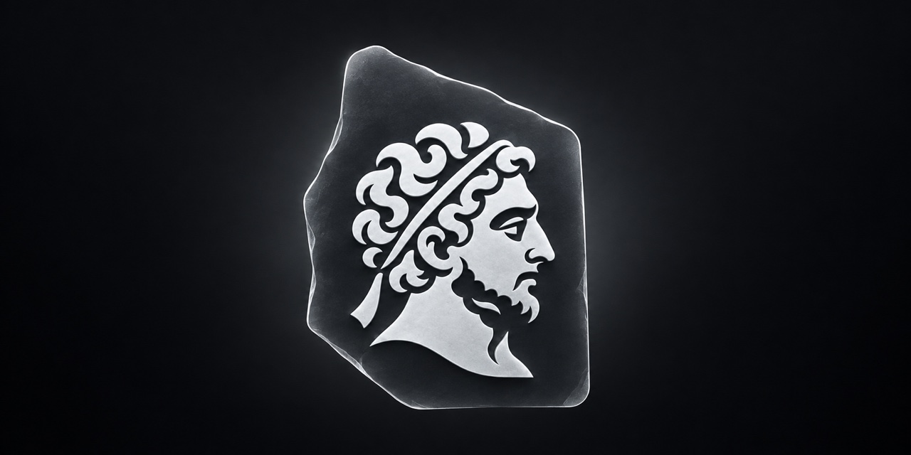
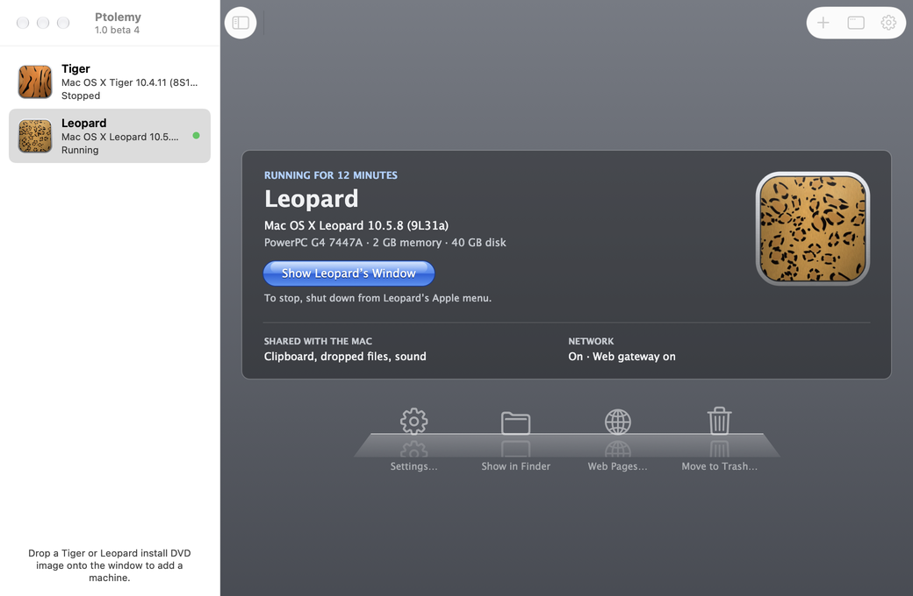
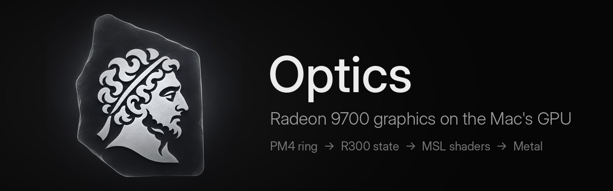
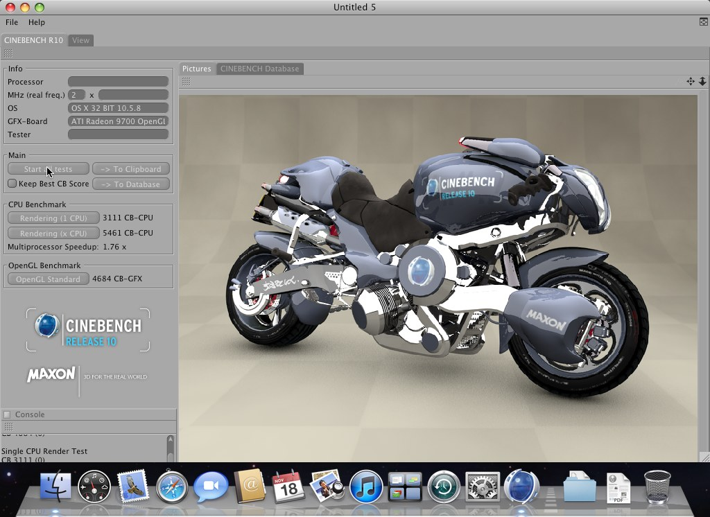

<p align="center"></p>

# Ptolemy

Ptolemy is a PowerPC Mac emulator for Apple silicon. It runs Mac OS X Tiger 10.4.11 and Leopard 10.5 for PowerPC,
unmodified (their own kernel, drivers, Finder and applications), in a window or full screen on a current Mac. The
PowerPC code is translated to ARM64 and runs on the Mac's CPU cores under Hypervisor.framework; Mac OS X's own ATI
driver drives an emulated Radeon 9700 whose 2D and 3D work runs on the Mac's GPU through Metal.

**1.0 beta 5.** A hobby project, made for fun by a human and several frontier models. Expect rough edges: most applications and games have never been tried.
[Download it](#download) · [what's new](#whats-new-in-beta-5) · [how it works](#how-it-works) · [build it](#building)

<p align="center"></p>

## In short

If you miss your PowerBook G4 or the Power Mac under the desk, Ptolemy gives you one back, in a window on your Mac.

- **Your own Mac OS X.** Make an image of your Tiger or Leopard install DVD, drop it onto Ptolemy's window, choose the
  disk size, and the installer runs as it did in 2005. Ptolemy does not include or download Apple software.
- **Faster than the fastest real G4, mostly.** In Geekbench 2 one emulated G4 scores up to about 5100 and two of
  them about 6100; the fastest real G4, a Power Mac G4 with two 1.42 GHz processors, averages about 1220. vecLib's
  FFT is only about as fast as on a real G4 (see [Known limitations](#known-limitations)).
- **3D on the Mac's GPU.** Mac OS X's own ATI driver believes it talks to a Radeon 9700, so Quartz Extreme, Core Image
  and OpenGL games run on the Mac's GPU: Halo, Doom 3, Half-Life (Xash3D) and SimCity 4 among those we tried. Classic
  runs inside Tiger with a Mac OS 9.2.2 System Folder you bring (Age of Empires plays).
- **Two G4s in Leopard.** Choose *PowerPC Dual G4 7447A* in a Leopard machine's settings.
- **At home on today's Mac.** The clipboard both ways, files dropped onto the window, disk images inserted as USB
  disks, sound, the network and the Mac's camera in Photo Booth. A web gateway lets the systems' own Safari open
  today's HTTPS sites.
- **Several machines.** Each has its own disk (up to 120 GB), processor (G3 750, G4 7400, G4 7447A, Dual G4 for
  Leopard) and memory (512 MB to 2 GB). Disks are sparse bundles: they take only the space they use.

## What's new in beta 5

Beta 5 is about graphics and the screen.

- **Sharper 3D.** 3D is drawn at 1.5 times the resolution the system asks for: *1.5× Sharper* in a machine's
  settings, beside *As the System Draws* and *2× Sharper*. *Smooth Scaling (MetalFX)* smooths any picture shown larger
  than the system draws it.
- **Fewer first-use stutters.** Ptolemy keeps the shader programs it has prepared and compiles them again in the
  background at the next start; a set gathered from Tiger and Leopard comes with the app. In Unreal Tournament 2004
  the wait for shaders on ONS-Torlan fell from about 13 s to 0.3 s in the second session.
- **More display modes.** A machine's settings choose the startup mode: *Fit the Screen* (the Mac's screen), or 4:3,
  16:10 or 16:9 from 640 × 480 to 2560 × 1600, the size of Apple's largest display of the time, the 30-inch Cinema HD
  Display. Displays in Mac OS X offers the modes up to the startup one. Larger modes are left to large screens: when
  *Fit the Screen* gives a screen at least that large, Displays also offers 3440 × 1440 and 3840 × 2160, sizes Tiger
  and Leopard were never made for. Screens wider than 2048 pixels no longer keep stale pieces of earlier pictures.
- **H.264 on the Mac's decoder.** Ptolemy Tools add a QuickTime codec, Ptolemy Video, that hands H.264 to macOS:
  QuickTime Player plays 1080p at 30 frames a second without dropping frames.
- **DrawSprocket games** such as Cro-Mag Rally start from the Ptolemy menu, *DrawSprocket Games*. Mac OS X's
  DrawSprocket hides their windows under its screen capture, on a real Mac too; Ptolemy Tools raise them above it.
- **Smooth scrolling.** Two-finger scrolling on a trackpad moves Mac OS X's windows smoothly, sideways too: the mouse
  Mac OS X sees is now an Apple Mighty Mouse.
- **OpenGL closer to the real card.** Antiochus now runs 438 OpenGL cases, most of them from Piglit, in Tiger and
  Leopard against Apple's software renderer. The fixes they led to: index buffers, 16-bit float and 10-bit colour
  render targets, the vertex programs' EXP and LOG, texture coordinates, depth read back by the CPU.
- **Faster AltiVec and floating point.** Epicycle keeps up to 11 AltiVec registers in the Mac's registers within a
  block. Floating-point operations that give an infinity or a result near zero, or run in a rounding mode other than
  round-to-nearest, now stay in translated code instead of going to the interpreter. Against the same build without
  these changes (Leopard on one G4 7447A, two sessions of two runs each): Xbench vecLib FFT +10% and +13%, Floating
  Point Basic +4.5% and +7%; Geekbench 2 and Cinebench R10 within run-to-run noise, on Dual G4 too; Geekbench's vector
  Stream Add is 7% slower.
- **Fixed:** the RSS Visualizer screen saver (a white screen), Photo Booth's effects in Leopard (Ptolemy quit), a
  hang at 3840 × 2160 in Leopard after a game, two pointers over an inactive window.
- **256 MB of video memory** by default (was 128 MB).

## Emulated, translated, native

Ptolemy is an emulator: Apple silicon cannot run PowerPC code, and every part of the PowerBook G4 that Tiger sees is
modelled in software. What makes it fast is where that work runs.

- **Emulated: the machine.** The board, disk, CD/DVD, USB, network, sound and the Radeon 9700 are models written for
  Ptolemy, close enough to the real hardware for Tiger's own drivers.
- **Translated: the processor.** Epicycle compiles Tiger's PowerPC code, the kernel included, to ARM64 one block at a
  time and keeps the translations; an interpreter handles rare instructions and corner cases.
- **On the Mac's hardware.** The translated code runs on the Mac's CPU cores inside a Hypervisor.framework vCPU. The
  Mac's MMU does the PowerPC's address translation through page tables that mirror Tiger's, so a guest load or store
  is an ARM64 load or store and a byte swap. The Radeon's drawing runs on the Mac's GPU: its vertex and fragment
  programs become Metal shaders.
- **Added to Tiger.** Ptolemy's display driver (modes up to the window's size, cursor, gamma), which the firmware hands
  to Tiger, and Ptolemy Agent (clipboard, file transfer, shut down), which Ptolemy.app installs with each machine.
  Both talk to Ptolemy through private calls instead of emulated hardware. Tiger's own files are not changed.

Hypervisor.framework gives the translated code a memory management unit and isolation; it does not run Tiger's code
as it is, the way a virtual machine runs a guest made for the same processor. Rosetta 2 is the nearer comparison: it
translates an Intel app's code for macOS, while Epicycle translates a whole PowerPC system, kernel and drivers
included, on emulated hardware.

## How it differs from other emulators

Ptolemy is a PowerPC Mac built from scratch for Apple silicon. The processor translator, the PowerBook G4 board with
its disk, CD/DVD, USB, network and sound, the Radeon 9700, and the tools inside Mac OS X are Ptolemy's own code,
written from hardware documentation and from what Mac OS X does; no code from other emulators is included. The one
borrowed part is the firmware, a fork of OpenBIOS (see [THIRD-PARTY.md](THIRD-PARTY.md)).

The usual way to run PowerPC Mac OS X on a Mac today is QEMU, directly or through UTM (SheepShaver runs Mac OS 9.0.4
and earlier, not Mac OS X). QEMU is a general-purpose emulator. Ptolemy is built around one machine and one kind of
host, and that is where its speed and its 3D come from:

- **Processor.** Epicycle generates ARM64 code directly, without an intermediate representation: PowerPC registers
  stay in ARM64 registers within a block, blocks are linked by direct branches, AltiVec runs on NEON, and floating
  point keeps PowerPC's rounding and FPSCR rules in translated code. It runs inside a Hypervisor.framework vCPU,
  where the Mac's MMU does the PowerPC's address translation, so a guest load or store is one ARM64 load or store
  and a byte swap. QEMU translates through its portable code generator (TCG) in an ordinary process and looks up
  every guest memory access in a software TLB.
- **Graphics.** Ptolemy's Radeon 9700 is close enough to the real card for Mac OS X's own ATI driver: its command
  processor and 2D engine are modelled, and its vertex and fragment programs become Metal shaders. Quartz Extreme,
  Core Image and OpenGL run on the Mac's GPU, with 3D drawn at 1.5 times the resolution the system asks for. QEMU's
  Mac board has a plain framebuffer: no Quartz Extreme, and OpenGL falls back to Apple's software renderer on the
  emulated processor.
- **Two processors.** Leopard runs on a Dual G4 with its own multiprocessor kernel and scheduler; Cinebench renders
  about 1.8 times faster with two.
- **At home on macOS.** A launcher in the style of macOS 26, sound through Core Audio, H.264 on the Mac's decoder
  through a QuickTime codec, the Mac's camera as a USB camera, the clipboard both ways, files dropped onto the
  window, and a web gateway that lets Safari open today's HTTPS sites.
- **Checked against the real thing.** The translator is tested instruction by instruction against its own
  interpreter and against Unicorn; Antiochus compares 438 OpenGL cases with Apple's software renderer in Tiger and
  Leopard.

On a MacBook Air with the M4, Tiger in Ptolemy scores about 5100 in Geekbench 2.2 and Leopard on a Dual G4 about
6100; the fastest real G4, a Power Mac G4 with two 1.42 GHz processors, averages about 1220, and Geekbench's
baseline, a Power Mac G5 at 1.6 GHz, scores 1000. Halo's built-in time demo runs at about 90 fps with 2× FSAA, and
Tiger reaches its desktop about 10 seconds after the machine starts.
Published Geekbench 2.2 results for Tiger in [QEMU 7.0 on an M1 Mac mini](https://browser.geekbench.com/geekbench2/2730728)
and [UTM 3.2.4 on an M1 Pro MacBook Pro](https://browser.geekbench.com/geekbench2/2730718) are 731 and 774. Those Macs
are older, but not seven times slower.

Ptolemy is deliberately narrower: one machine, two systems, one kind of host. QEMU runs on almost any computer and
starts many more systems: Mac OS 9, other versions of Mac OS X, Linux.
[ppcosxkvm](https://github.com/linuxkid473/ppcosxkvm), a QEMU fork, also emulates the Radeon 9700 for the ATI driver,
starts Jaguar as well and runs on Linux and Intel computers; it is worth a look if you are not on Apple silicon.

## How it works

### The machine

Ptolemy models a PowerBook5,8, the 2005 15-inch PowerBook G4: a G4 7447A at 1.67 GHz on a 167 MHz bus, 512 KiB of L2,
up to 2 GB of memory and a 25 MHz timebase. Mac OS X sees this machine in System Profiler and `sysctl`.

| Part | Model | Source |
|---|---|---|
| CPU | Epicycle: G3 750, G4 7400, G4 7447A, two 7447A | `epicycle/` |
| PCI/AGP host | UniNorth: configuration space, BAR assignment, AGP GART | `src/board.c`, `src/firmware.c` |
| MacIO | KeyLargo: OpenPIC interrupt controller, VIA and PMU (power, clock, battery), DBDMA, Screamer sound | `src/platform.c`, `src/pmu.c`, `src/dma.c`, `src/audio.c` |
| Storage | ATA disk, ATAPI CD/DVD-RW combo drive (SCSI/MMC commands), USB mass storage | `src/ata.c`, `src/atapi.c`, `src/scsi.c`, `src/usb_msc.c` |
| USB | OHCI with HID keyboard, absolute tablet and relative mouse; the Mac's camera as a UVC camera | `src/ohci.c`, `src/hid.c`, `src/input.c`, `src/usb_uvc.c` |
| Network | RTL8139 with user-mode NAT (no privileges) or vmnet | `src/net_rtl.c`, `src/net_user.c`, `src/net_macos.m` |
| NVRAM | Core99 flash (two banks) with the Open Firmware and Mac OS partitions | `src/nvram.c` |
| Graphics | Optics: ATI Radeon 9700 (R300) | `src/optics/` |
| Firmware | A fork of OpenBIOS (Open Firmware) | `firmware/openbios/` |

### Epicycle: the processor

Epicycle translates PowerPC code to ARM64 one block at a time, without an intermediate representation: superblocks, a
register cache per block, blocks linked by direct branches, a jump cache for indirect branches, compares fused with
the branches that follow them. It runs the code inside a Hypervisor.framework vCPU, with the guest's memory mapped into
the vCPU's stage-2 address space. The PowerPC MMU (BATs, segment registers, the hashed page table) is modelled in
`mmu.c`; translated code checks its assumptions and exits to the interpreter for rare instructions and corner cases.
Device accesses leave the vCPU as stage-2 faults or hypercalls and are handled on the host. Floating point follows
PowerPC rounding and FPSCR rules; AltiVec runs on NEON. [epicycle/README.md](epicycle/README.md) has the details.

### Optics: graphics on Metal

<p align="center"></p>

Optics, the Radeon 9700 model, works at the level of the card's registers and command ring, so Mac OS X's ATI driver,
OpenGL and Quartz Extreme run as they would on the real card. Each draw the driver sends becomes one Metal draw:

- the card's vertex and fragment programs become Metal shaders, with fog, clip planes, logic ops and the other
  fixed-function stages built in; while frames stream, a draw whose shader is still compiling waits up to 10 ms,
  then is skipped for that frame; the programs are kept for the next start;
- compute kernels decode textures on the GPU, DXT and YUV included;
- render targets are Metal textures that own the guest's video memory, and Hypervisor.framework's page protection
  tells Optics when the guest's CPU touches them; with FSAA they are multisampled and resolved on the GPU; 3D targets
  can be drawn at 1.5 or 2 times their size;
- the driver's fences and occlusion queries complete from Metal's completion handlers;
- the window presents through a `CAMetalLayer` at 60 Hz, scaled with MetalFX when it is larger than the picture.

The engine links Apple's frameworks only: no host OpenGL, no Vulkan layer, no shader cross-compiler.
[docs/metal.md](docs/metal.md) describes this in detail; [docs/graphics.md](docs/graphics.md) lists what the model
covers and what it does not cover yet.

### Two processors (Dual G4)

<p align="center"></p>

A Leopard machine can have two G4 7447A, as in a dual-processor Power Mac G4. Each processor runs on its own host
thread, and guest code on both runs in parallel on two of the Mac's cores.

- **One engine lock.** A processor's thread holds it whenever it is outside guest code: translating, handling an exit,
  running a device model, walking page tables. So the translator and the devices are used by one thread at a time,
  as with one processor; the lock is first come, first served. A change the other processor must not run across
  (code being thrown away, a page leaving its tables, the timebase's coefficients) first stops it at a block boundary.
- **Leopard starts the second processor itself**, as on the real machine: it is held in reset until the kernel
  releases it through KeyLargo. The OpenPIC delivers interrupts and inter-processor interrupts to both. Both read one
  timebase; each has its own decrementer.
- **Memory order.** Apple silicon reorders memory more freely than a G4. While two processors run, the PowerPC's
  barriers become ARM barriers: `sync` is `dmb ish`, `eieio` `dmb ishst`, `isync` `dmb ishld` and `isb`, and
  `stwcx.` a compare-and-swap. Correctness tests (atomic counters, message passing, store buffering, the timebase seen
  from both processors) find zero violations, idle and under load.
- **Idle.** An idle processor naps, and its thread first polls for a short, adaptive moment before it sleeps, so a
  quick hand-over between the two does not wait for a thread to wake.

What it costs: single-threaded work runs as with one processor, multithreaded Cinebench renders 1.76–1.84× faster, idle
takes about 1 s of host CPU a minute more, OpenGL is about 5% lower. Two threads fighting over one lock are much
slower than on one processor: each hand-over crosses into the Mac. Tiger keeps one processor: its kernel wakes every
processor 100 times a second, idle or not.

The screenshot is from beta 4, a separate run: 1.76× with two processors. Its OpenGL score, 4684, is below that
session's 5601; results on the Air vary from run to run.

### Inside Mac OS X: Ptolemy Tools

Ptolemy Tools run inside Tiger and Leopard and talk to the engine through private calls instead of emulated hardware.
The display driver, which the firmware hands to Mac OS X, gives display modes up to the window's size, a hardware
cursor and gamma. Ptolemy Agent, in the menu bar, carries the clipboard and files, restarts and shuts down the system in
order and, in Leopard, keeps the system from sleeping on its own. Ptolemy Video, a QuickTime codec, hands H.264 to the
Mac's decoder, and a small DrawSprocket helper lets full-screen games of the Mac OS 9 era show their windows. Ptolemy.app installs the Tools
into every new machine and updates them on machines made with an earlier beta; Tools someone else put in that place
are left alone. Mac OS X's own files are not changed.

### How it is tested

- `sh build.sh --test` builds the engine and runs its tests: the JIT against the interpreter, bare-metal PowerPC
  programs for the MMU and exceptions, each device model on its own, the graphics card's threads under
  ThreadSanitizer.
- **Antiochus**, in the Ptolemy Tools menu, runs CPU and GPU cases inside Mac OS X and compares every GPU image with
  Apple's software renderer.
- Each beta is measured against the one before with Geekbench 2, Cinebench R10 and Xbench, in the same window, one
  session after another.

## Components

| Name | What it is | Where |
|---|---|---|
| **Epicycle** | PowerPC G3/G4 to ARM64 JIT that runs inside Hypervisor.framework; AltiVec on NEON | `epicycle/` |
| **Optics** | ATI Radeon 9700 (R300) model: command processor, 2D engine, vertex and fragment programs translated to Metal. Tiger's own ATI driver drives it, so Quartz Extreme, Core Image and OpenGL games run on the Mac's GPU | `src/optics/` |
| **Harmonics** | Screamer sound and its DBDMA channels, played through Core Audio | `src/audio.c`, `src/audio_macos.c` |
| Machine | PowerBook5,8: G4 7447A 1.67 GHz, 2 GB, MacIO, PMU, ATA disk, ATAPI CD/DVD, USB keyboard, tablet, mouse and storage, RTL8139 Ethernet with user-mode networking, NVRAM | `src/`, `include/` |
| Firmware | A fork of [OpenBIOS](https://github.com/openbios/openbios) (Open Firmware), built reproducibly | `firmware/openbios/` |
| Ptolemy Tools | Runs inside Tiger and Leopard: display driver (modes, hardware cursor, gamma), clipboard, file transfer, orderly restart and shut down, H.264 for QuickTime on the Mac's decoder, DrawSprocket games | `guest/` |
| Ptolemy.app | Launcher: installs Tiger from your own DVD image, keeps several machines, sets disk size, processor and memory | `product/` |

The firmware is the only third-party code in the machine; everything else was written for Ptolemy.
[THIRD-PARTY.md](THIRD-PARTY.md) lists every outside component, including test-only ones.

## Download

`Ptolemy-1.0b5.zip` on the [Releases](https://github.com/dadanobel/ptolemy/releases) page holds Ptolemy.app with the
engine, the firmware and Ptolemy Tools. You need:

- A Mac with Apple silicon and macOS 15 Sequoia or later (tried on macOS 15 with an M1 Max and on macOS 27 with
  an M4).
- An image of your own Mac OS X Tiger 10.4 or Leopard 10.5 PowerPC install DVD (see below). Ptolemy does not
  include or download Apple software.

Unzip it and move Ptolemy.app to Applications. Ptolemy is signed ad hoc, not notarized by Apple, so macOS refuses to
open it the first time. Open System Settings → Privacy & Security and click Open Anyway next to the message about
Ptolemy, or remove the quarantine in Terminal:

```sh
xattr -dr com.apple.quarantine /Applications/Ptolemy.app
```

Then choose your Tiger or Leopard DVD image in Ptolemy (or drop it onto the window), set the disk size and start.
The installer runs in the window; when it restarts, Ptolemy copies Ptolemy Tools onto the new disk and starts the new
system from it. To update Tiger to 10.4.11, drop Apple's Mac OS X 10.4.11 Combo Update (PPC) onto the window: it arrives on
Tiger's desktop.

### An image of your install DVD

You need the disc and a DVD drive, such as Apple's USB SuperDrive.

1. Insert the DVD and open Disk Utility (Applications → Utilities).
2. Select the disc in the sidebar and choose File → New Image → Image from the disc (for example "Mac OS X Install DVD").
3. Choose the format DVD/CD master, no encryption, and save.

Ptolemy takes the resulting `.cdr` file, as well as `.dmg` and `.iso` images.

## What has been tried

On a 13.6-inch MacBook Air with the M4 (10-core CPU and GPU, 24 GB), macOS 27, with Tiger 10.4.11 and Leopard 10.5 on
the G4 7447A. Unreal Tournament 2004, Quake 3, Cro-Mag Rally, Office 2004 and the video were tried with this release;
Cinebench, Geekbench and Xbench in Leopard with this release (the best of up to four runs each), in Tiger with
beta 4; Leopard, Dual G4 and Photo Booth with beta 4; Classic and SimCity 4 with beta 3, Halo
with beta 1, Doom 3 with a build of the same day as beta 1, the others with builds of the weeks before.

| Software | Result |
|---|---|
| Mac OS X Tiger 10.4 | Installs from the retail DVD image; updates to 10.4.11 with the Combo update; Finder and Dock with Quartz Extreme |
| Mac OS X Leopard 10.5 | Installs from the DVD image; desktop with Quartz Extreme; System Preferences, Chess, Software Update |
| Halo (Universal) | Campaign plays. Built-in time demo at 800 × 600 with 2× FSAA and lens flares: 87–95 fps (two runs) |
| Doom 3 1.3.1 | Renders completely (ARB2 path). `timedemo demo1` at 640 × 480: 55 fps |
| Half-Life (Xash3D) | 1024 × 768: 430–650 fps, depending on the run |
| SimCity 4 | Starts from its disc image; tutorial cities render with their trees and buildings |
| Fallout 2 | 640 × 480 in 256 colours |
| Classic (Mac OS 9.2.2) | Starts in Tiger; Age of Empires plays |
| Cinebench R10 | Tiger: CPU 3138, OpenGL about 5200. Leopard: CPU 3194, OpenGL 5520. Leopard on Dual G4: x CPU 5771 (1.80×) |
| Geekbench 2.2 | Tiger 5084, Leopard 5111, Leopard on Dual G4 6097 (a real dual 1.42 GHz Power Mac G4 averages about 1220) |
| Xbench 1.3 | Tiger: User Interface 294, OpenGL 212, vecLib FFT 66. Leopard: CPU 155.8, Floating Point Basic 97.5, vecLib FFT 73.4 |
| Photo Booth (Leopard) | Sees the Mac's camera as a USB camera |
| Unreal Tournament 2004 (Leopard) | ONS-Torlan at 1024 × 768: about 65 fps |
| Quake 3 Arena (Classic) | Plays in Tiger; set `seta r_primitives "2"` in `q3config.cfg`, otherwise stray triangles cross the menu |
| Cro-Mag Rally | Full screen through *DrawSprocket Games* in the Ptolemy menu |
| Microsoft Office 2004 | Installs and runs in Leopard |
| QuickTime Player | 1080p H.264 at 30 fps, no frames dropped |

Everything else is untested. Reports are welcome.

## Classic Environment

You can download a Mac OS 9.2.2 System Folder for Mac OS X Tiger from the Internet (for example, the “Classic folder” archive from Macintosh Repository) and install it:

1. Unpack the archive on your Mac with The Unarchiver or StuffIt Expander. They keep the files’ resource forks, which Mac OS 9 needs.
2. In Finder, Control-click the unpacked folder and choose Compress. Finder’s zip keeps the resource forks.
3. In Ptolemy, choose Media › Insert Disk Image… and select the zip. Tiger shows it as a disk with the zip’s name.
4. In Tiger, drag the System Folder from that disk onto Tiger’s disk.
5. Open System Preferences › Classic, select that System Folder and click Start.

Don’t drag Mac OS 9 files onto Ptolemy’s window: that copy loses their resource forks.

## Known limitations

- **Graphics.** Every case of the OpenGL comparison test matches Apple's software renderer, but some details are
  approximate: edge flags in wireframe mode (every edge is drawn), the R300's 3- and 6-sample FSAA modes (drawn with
  4 samples) and its exact sample positions. See [docs/graphics.md](docs/graphics.md).
- **Time Machine.** In Leopard it stops with "The built-in network interface could not be found": the emulated
  Ethernet card is not marked as built-in. A fix is planned.
- **Sleep.** Mac OS X cannot sleep in Ptolemy: Tiger stops, Leopard hangs. In Tiger, set Energy Saver to never put
  the computer to sleep; in Leopard, Ptolemy Tools keep the system from sleeping on its own.
- **NVRAM.** Mac OS X's NVRAM is emulated as the Core99 flash it expects. The first start of a machine made with an
  earlier beta converts its NVRAM file once and keeps the original next to it as `nvram.bin.legacy`. Ptolemy chooses
  the startup disk itself, so Startup Disk has no effect.
- **Classic.** Classic (Mac OS 9 inside Tiger) needs a Mac OS 9.2.2 System Folder that you bring into Tiger yourself,
  in a disk image or a StuffIt archive (files dropped one by one lose their resource forks); Ptolemy does not include
  one. The first start takes about two minutes. As on real Macs, Classic has no hardware 3D: games that need a 3D card
  (RAVE, Glide, accelerated OpenGL) do not run there, while software 3D such as QuickDraw 3D's own renderer, which
  Bugdom uses, runs on the emulated G4. Mac OS 9 itself does not start: the firmware cannot start a disk that Tiger
  marked for Mac OS 9.
- **Files.** Files dropped onto the window arrive without resource forks, type and creator. One file can be up to 4 GB.
- **Benchmarks.** Most code runs several times faster than on a real G4, vecLib's FFT only about as fast: in Leopard,
  Xbench's vecLib FFT scores up to 73, a 1.33 GHz iBook G4 about 71.
- **Dual G4.** Leopard only (Tiger wakes every processor 100 times a second, which costs a second processor its idle
  time). Threads that hand one lock back and forth are much slower than on one processor, and software that shares
  memory without the PowerPC's barriers can misbehave more often than on a real dual G4.
- **Video.** Ptolemy Video decodes H.264 for QuickTime; other codecs run on the emulated G4 as before.
- **Not available:** two CPUs in Tiger, a G5, CD audio, game controllers, sound input, incoming network
  connections.
- **Mouse in games.** When a game switches the display mode, Ptolemy captures the mouse: Ctrl+Option or Cmd+Tab
  releases it, a click captures it again. A captured mouse can feel fast; lower the game's own mouse sensitivity.

## Plans

A multi-processor Power Mac G5 before 1.0. YouTube in the systems' own Safari, through the web gateway, in beta 6.

## Building

You need the Xcode command line tools and Python 3.

```sh
sh build.sh --test        # the engine (build/ptolemy-engine) and its tests
```

The firmware ROM, Ptolemy Tools and the app have their own steps: see [docs/building.md](docs/building.md).

## Documentation

- [docs/architecture.md](docs/architecture.md): how the pieces fit together
- [docs/building.md](docs/building.md): building the engine, the ROM, Ptolemy Tools and Ptolemy.app
- [docs/metal.md](docs/metal.md): how Ptolemy uses Metal
- [docs/graphics.md](docs/graphics.md): what the Radeon model covers and what it does not cover yet
- [epicycle/README.md](epicycle/README.md): the CPU engine and its tests

## License

GPL-2.0-or-later. See [LICENSE](LICENSE). Mac OS X, Metal, Halo, Doom 3 and the other names above are trademarks of
their owners; Ptolemy is not affiliated with Apple or with any of them.
