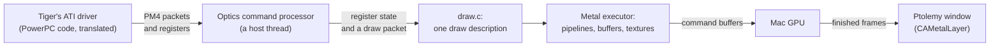

# How Ptolemy uses Metal

Tiger draws through its own ATI Radeon driver, unchanged. Ptolemy models the card, an ATI Radeon 9700 (R300), and does
the card's work with Metal on the Mac's GPU. Metal is used in two places: Optics, the model of the card's 2D and 3D
engines, and the window that shows the screen. The engine links Apple's frameworks only: no host OpenGL, no Vulkan
layer, no shader cross-compiler (the build checks this).

## One R300 draw, one Metal draw

The driver writes register values and PM4 command packets into a ring in guest memory, as it does on the real card.
Optics' command processor runs the ring on its own thread. Register writes update a model of the card's state; a draw
packet is decoded against that state into one description (`src/optics/draw.c`): where the vertices are and in which
formats, the vertex and fragment programs, the rasterizer, the textures, blending, depth and stencil, and the target.

The Metal executor (`src/optics/frontend_metal.mm`, `src/optics/renderer.mm`) turns the description into one Metal
draw. Vertex elements are read from guest memory in the R300's stream formats and passed to the vertex shader in a
shared buffer; quads, strips, fans and polygons become indexed triangles. The guest's vertex program runs in the Metal
vertex function, with the viewport transform as its epilogue. When the card generates geometry itself (point sprites,
wide lines, stippled lines), the driver bypasses the vertex program, or the viewport transform is not the standard
one, the vertices are transformed on the CPU and drawn through a pass-through vertex function. Scissor, culling, depth
bias, stencil reference and blend colour are dynamic state of the render pass. Up to 512 draws share one command
buffer.

## The card's programs as Metal shaders

The R300 runs two kinds of programs: vertex programs (PVS) and fragment programs (US). Optics decodes both into an
intermediate form (`src/optics/foundation/shader_decode.c`) and writes it out as Metal Shading Language
(`shader_msl.c`). A reference interpreter (`shader_eval.c`) runs the same form on the CPU; the tests compare the two.
Shaders are compiled with `MTLMathModeSafe` and keep the card's rules where they differ from IEEE defaults, such as
the reciprocal of zero. Each program, with the fixed-function state it depends on, is compiled once and cached.

The fixed-function units around the programs become a few lines of the same shaders:

| R300 unit | In the shaders |
|---|---|
| Viewport transform (SE) | Vertex shader epilogue |
| User clip planes | `[[clip_distance]]` |
| Fog (FG): linear, exp, exp2 | Fragment shader, from the fog factor the vertex program writes |
| Alpha test, colour key, stipple | Fragment shader: `discard_fragment` |
| Logic ops | The fragment shader reads the target (`[[color(0)]]`) and combines |
| LOD bias, border colours | Sampling functions |
| Polygon stipple coordinates | Generated from the fragment position |

## Textures

Guest texture bytes, in video memory or in AGP memory, are copied into a Metal buffer once. A compute kernel unpacks
every R300 format into RGBA8 textures: 8-, 16- and 32-bit formats, DXT1/3/5, YUV 4:2:2, tiled layouts and the card's
byte swaps, for 2D, cube and 3D textures. Float textures are expanded to RGBA32Float on the CPU. Decoded textures are
kept across draws: by address in video memory, and by content in AGP memory, where the CPU writes unseen. Samplers are
Metal sampler states built from the R300's filter, address, mip and anisotropy settings.

## Video memory and render targets

Tiger's CPU maps the card's video memory and may read or write any of it. A colour buffer that the GPU draws into
lives in a Metal texture that owns that range of video memory. Hypervisor.framework's page protection on the guest's
view of video memory tells Optics when the CPU touches the range:

- a CPU read writes the texture back into video memory first, in the guest's pixel format;
- a CPU write hands the memory back to the CPU, and the next draw imports it again.

The 2D engine's blits and fills work on video memory in the same way: a GPU-owned surface is written back before they
read it. The display is not: when the screen is a GPU-owned surface, the window gets a GPU copy of it. Depth and
stencil live in `Depth32Float_Stencil8` textures. When the CPU reads a depth buffer (`glReadPixels` of depth, Halo's
lens flares), the rows it reads are exported first in the card's depth format. A target in guest RAM (OpenGL readback)
is drawn into a temporary texture and written back before the draw completes.

## Completion

Tiger's driver waits for the card through fences and the command processor's scratch registers. Optics completes them
from Metal's command buffer completion handlers, so the driver sees the GPU finish in the order the real card would.
Occlusion queries (Halo) use a visibility result buffer in counting mode; the counts are written into guest memory
when the command buffer completes.

## The window

The window presents frames through a `CAMetalLayer` at 60 Hz. A fragment shader turns the guest's framebuffer into the
drawable: 8 bits through the colour table, 16 or 32 bits in either byte order, or the GPU copy of a GPU-owned screen.
The same shader draws the 64 × 64 hardware cursor, applies the gamma ramp of Ptolemy's display driver (fades and
brightness) and scales the picture to the window or the screen.

## What does not use Metal

The CPU: Epicycle translates PowerPC code to ARM64 and runs it under Hypervisor.framework. The 2D engine's blits and
fills run on the host CPU. What the R300 model covers and what it does not cover yet is listed in
[graphics.md](graphics.md).

Metal is a trademark of Apple Inc., registered in the U.S. and other countries and regions.
