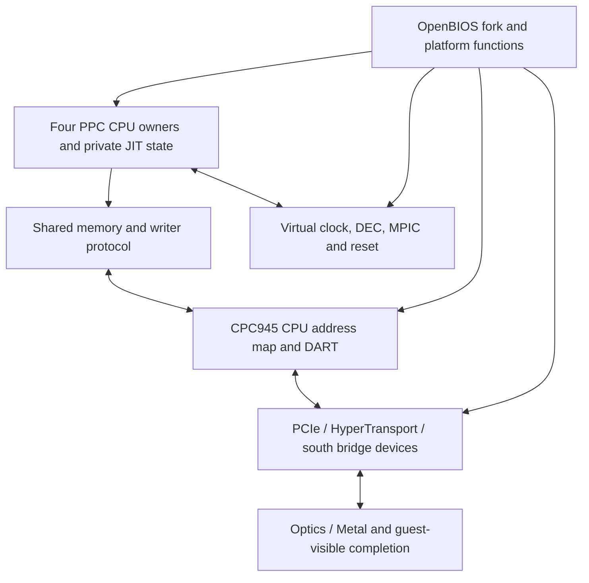

# Quad G5 architecture and integration decision

Date: 2026-11-04. Target: Apple Silicon hosts, Metal graphics, PowerPC Tiger/Leopard guests. This is a design and source-backed research report accompanying an incomplete, tested foundation. It does not certify a complete G5 implementation.

## Decision

Build a separate 970MP CPU/board profile, preserving the current G3/G4 product. Use four persistent host execution owners, one per guest CPU, and one shared memory/device domain. Start acceptance with one owner. Do not turn four instances of the current global G4 engine into a purported Quad.

A Quad profile is justified by SMP-capable applications and large-memory workloads. It is not a demonstrated performance fix for existing single-threaded workloads. G5 identification alone does not make FP faster. Better lowering, residency of guest registers, memory translation and reduced synchronization remain necessary on both G4 and G5.

The factory Quad used two dual-core processors, PCI Express and configurations up to 16 GB. Apple's own application comparisons varied substantially; its marketing measurements are not predictions for Ptolemy. The historical comparison target should be specified by workload and configuration, not by the sum of advertised GHz. [Apple introduction](https://www.apple.com/uk/newsroom/2005/10/19Apple-Introduces-Power-Mac-G5-Quad-Power-Mac-G5-Dual/).

## What the requested 1:1 can mean

**One guest CPU to one persistent host execution owner is implementable.** The native fixture in this package demonstrates four concurrent HVF owners. A host scheduler still decides which physical cores run them. Four guest CPUs do not grant four dedicated performance cores. Account for render, audio and the rest of macOS. Apple's scheduling guidance explicitly notes that performance cores may become unavailable under thermal constraints. [Apple scheduling guidance](https://developer.apple.com/videos/play/tech-talks/110147/).

**One PPC instruction to one ARM instruction is possible for selected operations, not the whole ISA.** This package executes eleven such lowerings on ARM EL1. Operand setup, PC/accounting, flags, exceptions and memory are outside that one instruction. A big-endian load commonly needs address translation, the load and byte reversal. Floating-point status and exceptional cases can require more. Do not call a single lowering a one-instruction complete guest dispatch.

Hypervisor.framework executes ARM code; it does not execute PowerPC. The JIT must remain a CPU translator. Metal should execute graphics and explicitly designed bulk workloads; moving arbitrary guest kernel execution to Metal would introduce a new memory/exception/scheduling problem. Guest-to-host APIs in PtolemyTools may offer opt-in acceleration services, but cannot silently replace arbitrary instructions or change their visible results.

## CPU semantics that change the implementation

The 970MP has two cores per chip, a 64-bit effective address, a 65-bit virtual identity and a 42-bit real-address model. Its software-managed SLB has 64 entries; page sizes include 4 KiB and 16 MiB. Cache/reservation granularity is 128 bytes, but dcbz behavior also depends on HID5 and instruction form. An SF=0 context still has 64-bit GPRs: truncating every result is wrong. DEC on this implementation is negative-level sensitive, unlike a generic edge-only description. L1 instruction/data capacities are 64/32 KiB and L2 is 1 MiB per core. These properties describe guest behavior; they do not require software cache-latency simulation. [IBM 970MP User's Manual 2.3, especially chapters 2, 4 and 5](https://datasheet.datasheetarchive.com/originals/library/Datasheets-SW3/DSASW0048145.pdf).

Instruction encodings, comparison/record behavior, the hashed page-table format and storage protection must be read with the implementation supplement. The supplied integer executor uses canonical CR fields, avoids overflowing subtraction for comparisons, preserves GPR upper halves in SF=0 and refuses unknown instructions without altering state. That establishes an oracle for the implemented subset, not complete coverage. [IBM 64-bit Programming Environments Manual 3.0](https://ftp.jaist.ac.jp/pub/NetBSD/misc/macallan/pem_64bit_v3.0.2005jul15.pdf).

### Coverage ledger

| Area | Delivery status | Required before advertising full 970MP support |
|---|---|---|
| Integer64 rotate/shift/multiply/divide and selected scalar arithmetic | Reference subset tested | Every required encoding and legal/illegal form; word operations with 64-bit storage; aliases and record/overflow modes |
| Load/store, branch and reservations | Reservation bus tested; no full instruction dispatcher | LD/STD families, update restrictions, alignment, byte reversal, page crossing, LR/CTR/address-width behavior |
| SLB and HPT | Standalone helpers tested | Decoder, privileged checks, fault registers, native mappings and precise exception delivery |
| FP/VMX | Existing project not widened or certified by this package | fctid/fctidz/fcfid, FPSCR/FE/NI rules, recovery, full VMX, unavailable and assist behavior |
| System instructions | dcbz size and coordination helpers only | rfid/rfi/MSR forms, SPR/SCOM/HID/PIR/HIOR, cache operations, sync/eieio/isync, tlbie/tlbsync, reset and machine-check paths |
| Hypervisor architecture | Not implemented | Explicit policy and required HV/HSRR/HDEC behavior for the actual guest kernel |
| Performance/debug facilities | Not implemented | Match required guest probes; unsupported operations must not silently succeed |

Use an instruction ledger indexed by encoding, mode, side effects, faults and native lowering. A list of recognized mnemonic names is not full compatibility. Add compiler-generated PPC and ppc64 probes, hand-coded boundary cases, and independently specified expected results. A comparison against the same helper alone is insufficient for FP/MMU certification.

## The complete wrapper: modules still to connect or implement

This is the proposed completed machine, not a diagram of already integrated code.

| Work item | Observable contract and completion condition |
|---|---|
| CPU topology and startup | Stable PIR-to-owner mapping, reset state, park/release protocol, CPU nodes and processor-start route agree. Both cores of both virtual chips actually execute and acknowledge startup. |
| Clock synchronization | Common oscillator; required platform function/GPIO/I2C interactions work; writable TB halves and rendezvous preserve order. CPU clocks are not inferred from host CPU frequency. |
| MPIC | Exact board register variant, destinations and interrupt-parent graph; asynchronous wakeup, acknowledge/EOI and nested priorities; restart resets in-service state safely. |
| Memory controller | RAM banks, reserved/I/O holes, CPU decode and OF memory properties describe the same bytes. Published RAM never includes JIT-private memory, framebuffer or controller windows. |
| DART | Register programming, table layout, permissions, invalidations and fault reporting match the guest driver. Old mappings cannot be reused after acknowledged invalidation. |
| PCIe/HT/south bridge | Configuration space, bridge windows, BAR probing, reset and IRQ routing agree with actual devices. Do not reuse an AGP address layout while claiming a factory PCIe machine. |
| SMU/I2C/GPIO | Implement the commands and platform functions reached during boot, secondary startup, timebase management, power control and sleep. Unknown operations are recorded and fail explicitly. |
| Storage/USB/audio/network | Route existing independently implemented devices through the new board and DMA domain; preserve their negotiated address widths. No broad device rewrite solely to change the CPU name. |
| Graphics | Keep Optics/Metal, but provide a coherent PCI/device-tree/driver-matching identity and correct DMA path. Test completion visibility above 4 GiB, GART, depth/MSAA and CPU access. |
| Firmware | Build and test the OpenBIOS fork for the new map/CPU environment; OF client interface, BootX allocations and handoff support high RAM and reserved regions. No Apple ROM is distributed. |
| Lifecycle | Pause all relevant clocks/owners, exit HVF safely, drain device/render ownership, restart a new epoch, then release memory. Test shutdown during pending DMA and CPU startup. |

Apple's October 2005 developer note identifies PowerMac11,2 and a north/mid/south-bridge architecture, SMU support, PCIe graphics, SATA and an ATA optical drive. It documents a system shipping with 10.4.3. This is materially different from the current PowerBook profile or an early AGP G5. Do not assume a retail 10.4.0 DVD has the required late-machine support. Prefer an already updated 10.4.11 installation for initial bring-up, and treat the user-facing installer strategy separately. [Apple late-2005 developer note, preserved mirror](https://leopard-adc.pepas.com/documentation/Hardware/Conceptual/PowerMac_G5_05Oct/Articles/PwrMacG5-0510_archi.html).

The exact bridge register personality, addresses, device-tree platform-function payloads and reset routing still need implementation-specific validation. This package intentionally does not invent a board identity or hard-code an unverified complete map.

### Why four CPU nodes are not enough

Apple's published `MacRISC4CPU.cpp` has a fallback that limits CPU count when it cannot find a timebase synchronization mechanism. Its startup and IPI methods then depend on platform services. Relevant functions are `start`, `startCPU`, `signalCPU` and `enableCPUTimeBase`. This makes firmware/platform support a boot requirement, not UI metadata. Pin the version matching the selected Tiger/Leopard guest; the published repository default is not proof of a particular shipping kext's exact behavior. [AppleMacRISC4PE source](https://github.com/apple-oss-distributions/AppleMacRISC4PE/blob/main/MacRISC4CPU.cpp).

Implement the referenced behavior end to end. A property that names a nonexistent platform function is worse than an explicit unsupported profile because it may let startup proceed into a dead wait.

## Memory and DMA design

Keep at least four types conceptually separate: guest effective address, guest physical address, device logical address and host IPA/VA. Use explicit fixed-width types at every callback and serialized boundary. Widening a pointer inside the CPU while keeping `env_mmio(uint32_t pa)` loses the upper address before any device sees it.

CPC945 accepts a 40-bit I/O address domain and its DART emits a 36-bit memory address. Its DART table contains valid/read-protect/write-protect fields, with distinct translated and bypass regions. This is different from the 970MP real-address width and from an arbitrary host's IPA limit. The delivered DART walker implements table lookup and protection with explicit faults. It is not a complete CPC945 register model. [IBM CPC945 UM A15-6010-02a, sections 3.4 and 12.9.19–22](https://datasheet.datasheetarchive.com/originals/library/Datasheets-SW3/DSASW0048084.pdf).

For the initial board, enforce its actual address limits even though the generic CPU helper accepts 42-bit real addresses. Query HVF limits; do not infer them from the marketing name M1/M4. The local fixture reported default IPA width 36 and maximum 40. That is one host observation, not a portability promise.

Start with 2 GiB for boot isolation, then 4/8/16 GiB. Treat 32 GiB as an experimental guest capacity gate until boot, all high-address DMA, application pressure and restart pass. On a 16 GiB host, allocating 16 GiB to the guest leaves no room for macOS, Metal and the translator. Select a conservative configurable default, track actual resident memory and compression, and reject a configuration exceeding the measured budget. Do not promise a fixed universal percentage or force the guest to use all installed host RAM.

For shared host memory, reserve long-lived backing, map banks deliberately and keep Metal resource lifetimes independent from guest page-map lifetimes. A guest mapping can disappear while a GPU command still owns the backing allocation. Release after the completion epoch, not after guest unmap alone. A DART invalidation changes future translations; previously accepted DMA requires a separately defined completion contract.

Community experiments above the official G5 memory configuration identify a concrete OF trap: `/memory/reg` can use two address cells but only one size cell, so a 4 GiB size cannot be stored in one entry. Preserve I/O holes and split ranges. The supplied encoder does this without assuming entries correspond one-to-one with DIMMs. The forum result is useful evidence for the firmware interface, not certification that every Tiger build supports our proposed 32 GiB profile. [Original G5 RAM experiment](https://forums.macrumors.com/threads/a-quick-start-guide-to-g5-ram-shenanigans-to-18gb-and-beyond.2482947/).

Large installed RAM also does not change the ABI of an existing 32-bit process. Apple distinguishes ILP32 and LP64; address width, framework availability and executable slices must be assessed separately. Extra memory can still help several processes and the system cache. [Apple 64-bit transition guide](https://developer.apple.com/library/archive/documentation/Darwin/Conceptual/64bitPorting/transition/transition.html), [Apple driver/DMA considerations](https://developer.apple.com/library/archive/documentation/Darwin/Conceptual/64bitPorting/KernelExtensionsandDrivers/KernelExtensionsandDrivers.html).

## Fast SMP without a new global bottleneck

The delivered serialized bus is a correctness reference. The production path should use direct translated loads/stores for eligible RAM and precise slow paths for reservations, protected pages, devices and guest-visible ownership changes. The optimization must retain a sound protocol for **every writer**, including GPU and Tools; CPU-only correctness is insufficient.

A per-granule version counter plus a later compare-and-store is not sufficient by itself: a writer can race the check, and an ABA/same-value store must still break the reservation. Coordinate the check and commit with all competing writers. ARM LDXR/STXR is useful, but its implementation granule and exception behavior cannot be assumed identical to PPC. Optimize from the reference with adversarial tests, then remove global serialization only where the proof still holds.

Translation caches require a common invalidation protocol. Begin with full per-owner flush acknowledgment, then specialize to address-space/range invalidation. ASID reuse must be safe across all owners of the host VM, including migration; use a coordinated allocator or disjoint owner namespaces with a global rollover protocol. Do not depend on a thread staying on one physical core. Separate physical code identity from effective-address/mode assumptions when sharing JIT code.

Publication of generated code needs both data visibility and instruction-cache synchronization. Preserve precise recovery at faultable operations and asynchronous exits. MMIO must preserve the device's ordering and side-effect counts. A host memory barrier does not wait for an asynchronous Metal command to finish; GPU completion must be published by an actual completion ticket before the guest observes the corresponding result.

For speed, retain typed integer/FP values across regions, specialize only with guards, reduce repeated endian conversions where safe, and share immutable decode/IR work. Keep mutable register maps owner-local. Profile guest work, translation, native execution, kernel waits, owner rendezvous and rendering separately. A four-owner configuration that slows the single-thread baseline is not an automatic win.

## What Xenon and community work actually contribute

Microsoft's Hot Chips presentation describes three in-order cores, two hardware threads per core, a shared L2, VMX128 with 128 vector registers, and explicit CPU/GPU data-streaming paths. G5 does not acquire those features by sharing the PowerPC family name. The useful transfer is the discipline of explicit data ownership, batching and avoiding copies, not Xenon's opcode/register layout or six-thread topology. [Microsoft engineers' architecture presentation](https://old.hotchips.org/wp-content/uploads/hc_archives/hc17/3_Tue/HC17.S8/HC17.S8T4.pdf).

Free60 is a valuable homebrew entry point, but its summary includes adding core clock rates and an overly broad G5 ancestry/ISA description. Those are not acceptable specifications for a 970MP implementation. Verify claims against the original hardware documents; homebrew bring-up notes can suggest probes, not replace them. [Free60 Xenon notes](https://free60.org/Hardware/Console/Xenon_%28CPU%29/).

The Snow Leopard PPC community's development thread explicitly distinguishes `ppc970` from `ppc64`. A G5-targeted binary can still use the 32-bit ABI. Its build reports and toolchain work are useful for future probe corpora, but development previews, reconstructed components and mixed releases do not establish Tiger/Leopard driver compatibility. Inspect the actual Mach-O slices and guest kexts. Keep 10.6 work outside the first G5 acceptance matrix. [Community development and toolchain discussion](https://forums.macrumors.com/threads/10-6-snow-leopard-powerpc-development.2439769/).

The Hackintosh/PowerMac modification scene provides useful negative controls for driver matching: one firsthand GPU-upgrade report found worse results after changing cards. Use that as a prompt to verify acceleration, device properties and the selected code path rather than trusting a model string. It is not proof of a general performance law, and x86 ACPI/SMBIOS tricks do not implement MacRISC4 startup. [Original G5 GPU-upgrade report](https://www.insanelymac.com/forum/topic/128283-7800gs-oc-in-powermac-g5-dual-20/).

## Performance expectations and acceptance

Use `tools/scaling.py` to make assumptions explicit. With 90% parallel work, equal one-core throughput and added overhead of 5% of the original runtime, the model predicts 2.67x for four owners. At 50% parallel work under the same assumptions it predicts 1.48x. These are calculations, not measurements. A predominantly single-threaded game can gain almost nothing from Quad and can lose performance through contention.

Rendering/export, parallel image processing and sufficiently independent audio tracks are candidates for application-specific tests. Do not assign speedup percentages to iLife, Shake or Logic without a repeatable project and the actual application build. Record one/two/four-owner elapsed time, correctness, CPU utilization, guest waits, host pressure, energy and thermal state. Test real-time audio by deadline misses as well as throughput.

Recommended release gates:

1. G3/G4 baseline remains correct and within its agreed performance budget.
2. One 970MP owner passes the instruction/exception ledger and boots the selected Tiger and Leopard builds.
3. High memory survives CPU, storage, graphics and Tools integrity tests, including unmapped and protected negative cases.
4. Two/four owners survive repeated startup, IPI/EOI, TLB shootdown, same-line reservation contention, pause, restart and shutdown.
5. Representative applications produce matching results; FP behavior is not relaxed for benchmark scores.
6. Sustained gains exceed measurement noise on both an entry Apple Silicon host and the development Mac. Graphics/audio do not starve.

The current package reaches standalone component and host-feasibility verification. It reaches none of the OS boot or release gates above. The full Quad G5 wrapper is still an engineering task; the concrete modules and tests here make its next steps reviewable rather than speculative.

## Implementation update, v2 (2026-11-04)

`g5_owners` now supplies persistent owner threads and backend lifecycle wiring. The
backend still must provide a per-owner production JIT and actual native mapping
synchronization. Its callbacks may publish additional work but may not synchronously
wait for their own acknowledgment; the cross-thread kick callback must not reenter
the coordinator. The controller can use a bounded condition-variable wait, avoiding
a busy spin. Destruction is joined, not timed-detached.

`PtG5Translation.writable` is permission to install an ARM writable mapping. A
translated read with PTE.C clear returns read-only even if PPC PP/key permissions
would allow a later write. That later write must set C through the compare-update
path first. This is separate from a guest protection failure.

The current product direction is Tiger/Classic on G4 and Leopard on G5. Single-G5
bring-up must precede high-RAM and Quad acceptance. The G4 Leopard work remains
a useful diagnostic because the memory-pressure corruption also appears in Tiger.

The host exit contract is documented by Apple: [hv_vcpus_exit](https://developer.apple.com/documentation/hypervisor/hv_vcpus_exit(_:_:)) also cancels the next run when the target is not currently running.
The installed Xcode SDK `hv_vcpu.h` documents the same contract, and the v2 fixture
uses that API on four actual owners. Do not replace it with a transient running-bit
check that can lose a pre-entry request.
